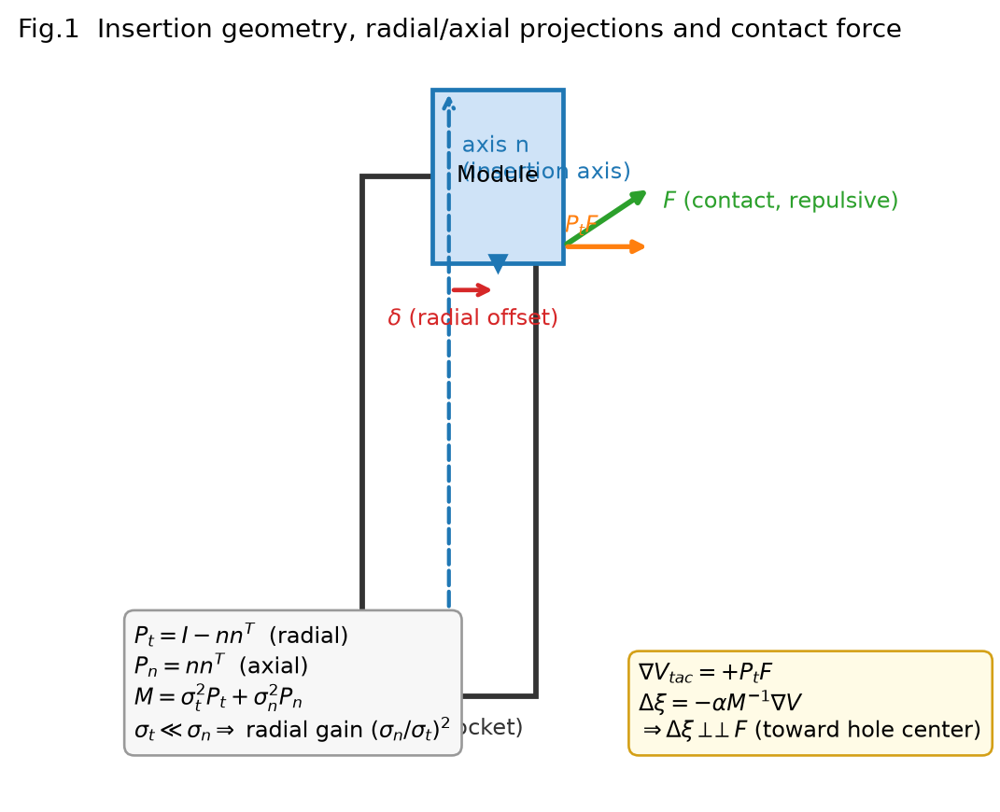
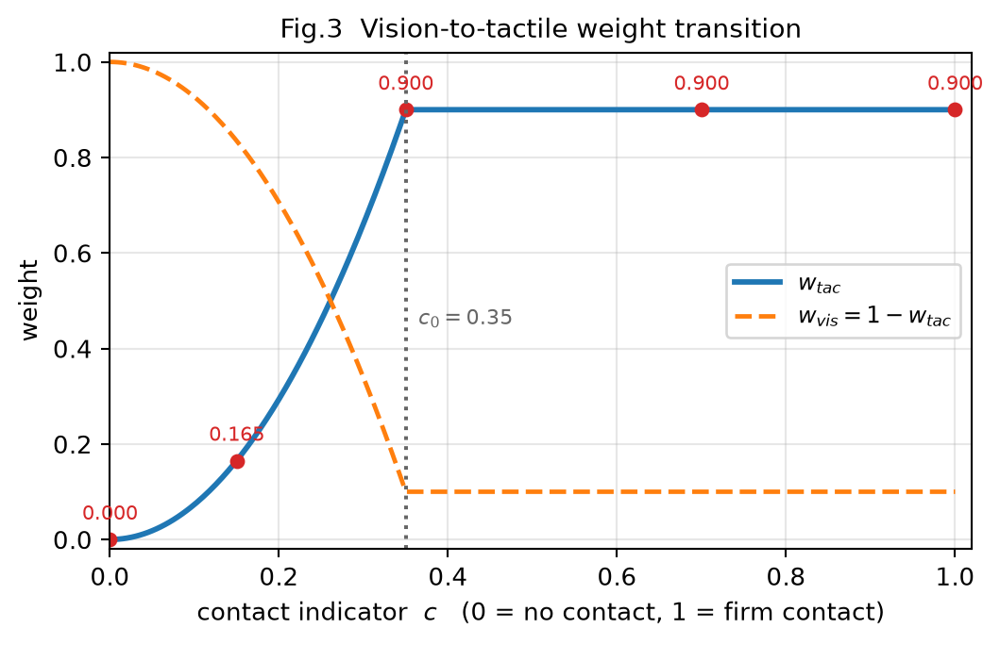
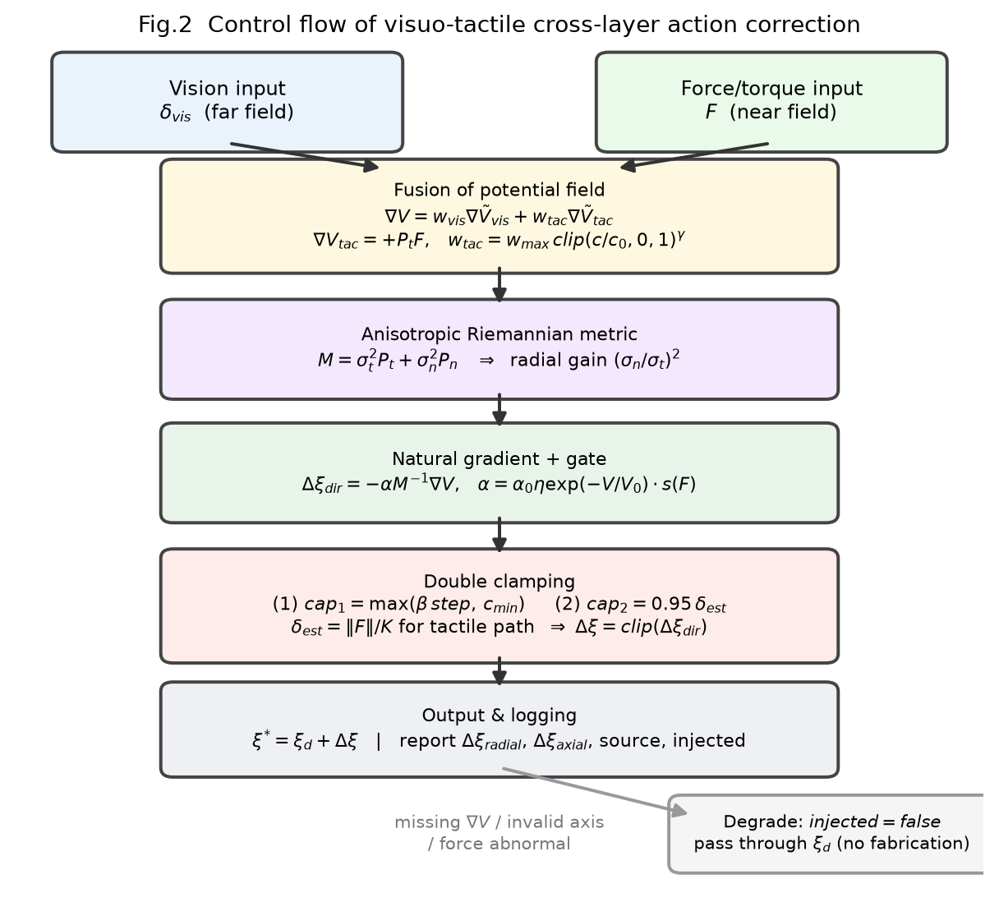

# 一种基于视触觉融合与装配公差度规的跨层动作修正方法及系统

| 项 | 内容 |
|---|---|
| 申请编号 (内部) | ZMP-2026-013 |
| 版本 | **v3 · 定稿（审查员+研发总监双审通过）** 2026-11-11 |
| 取代 | v1 纯视觉版、v2 视触觉融合初版（均归档于 `_v1_历史/`） |
| 与技术核心的关系 | 状态空间工程「度规即约束」在**动作层**的落地，与状态空间度规并列 |

> **v3 相对 v2 的变更**：① 明确单拍修正绝对下限参数 `c_min`；② 参数集中为表格；
> ③ 增加三幅附图（几何投影 / 控制流 / 权重过渡）；④ **正式提交版脱敏**——正文不含任何
> 具体代码路径，实现结构以"功能模块职责"描述；⑤ 补充权利要求 11（代理量同源禁止项）。
> v2 已修正的两处会导致工程失效的细节（∇V 符号、触觉限幅量纲）在 §9 保留实测反例。

---

## 1. 发明名称

一种基于视触觉融合与装配公差度规的跨层动作修正方法及系统

## 2. 技术领域

本发明属于具身智能与精密装配机器人技术领域，具体涉及分层运动控制系统中几何推理层与动作生成层之间的跨层动作修正接口，尤其涉及光模块、连接器、销轴等亚毫米级盲插配作业中的视触觉融合控制。

## 3. 背景技术

现有分层具身控制架构在精密装配任务中存在四项缺陷：

**3.1 纯视觉方案在盲插区失效（"接触即盲"）**
亚毫米级插配中，视觉在远场可提供粗对齐引导；但插头进入孔口后的"盲插区"，受遮挡、光照、景深与相机分辨率限制，无法分辨 0.1 mm 级径向偏差。此时视觉梯度不再指向真实误差方向，甚至给出错误符号。

**3.2 跨层数据断链（"假注入"）**
分层架构中，上层推理特征常被直接拼接到下层动作网络输入端。若该通道未经充分训练，其权重接近随机初始化，等同于向动作注入随机噪声——上层几何量在形式上"连上了"，实际上毫无约束力。本申请人实测：该通道权重标准差仅 0.02 量级，输出对动作的影响与噪声无法区分。

**3.3 缺乏物理接触约束**
纯视觉预测误差在接触瞬间若未经力学反馈修正，极易造成硬碰撞、刮擦孔壁乃至损坏器件。而力觉恰恰在盲插区是最可靠的信号源。

**3.4 各向异性被忽略**
装配公差天然各向异性：径向单边间隙常为 0.1~0.5 mm（极严），轴向推进行程 1~10 mm（极宽）。各向同性代价会导致径向纠偏不足（刮擦）而轴向过度干预（硬怼）。

## 4. 发明内容

### 4.1 核心思想

将精密装配中的**视觉几何推理**（远场、粗对齐）与**接触力觉反馈**（近场、盲插微调）融合，构造统一的**装配势能场 V**，并依据**物理装配公差**构建各向异性黎曼度规 M。在动作层，**不依赖重训练网络通道**，而用解析法把几何/力学梯度映射为动作修正量，使动作在径向（防刮擦）与轴向（控进深）上获得符合物理直觉的分配。

一句话：**远场信视觉，接触信力；方向由度规定，幅度由限幅守。**

*图 1　插配几何与投影示意：约束轴 n、径向投影 P_t、轴向投影 P_n，以及接触力 F 的径向分解。*

### 4.2 步骤 1 · 构造视触觉融合的装配势能场 V 及其梯度 ∇V

**(a) 远场视觉项**

    V_vis = ½ δ_visᵀ W δ_vis ,  ∇V_vis = W δ_vis

δ_vis 为视觉估计的位姿偏差，W 为轴向/横向权重阵（本实施例 W = diag(0.4, 1.0, 1.0)）。

**(b) 近场触觉项 —— 力的方向即势能上升方向**

接触力是**排斥力**：孔壁把模块推离孔心。因此力的方向正是势能增大的方向：

    ∇V_tac ∝ +F_radial = +P_t · F ,   P_t = I − nnᵀ

n 为插入轴。轴向分量被 P_t 剔除——轴向是插深通道，不应由侧向接触力纠偏。

> ⚠️ **本式符号易错且反向后果严重**：直觉会写成 ∇V ∝ −F（"力指向低谷"），
> 但代入 Δξ = −αM⁻¹∇V 后，−(−F) 会把模块**推离孔心**，比不修正更糟。
> 实测反例见 §9.1。正确关系 ∇V ∝ +F ⇒ Δξ = −αM⁻¹F 指向孔心（力的反方向）。

**(c) 融合**

    ∇V = w_vis·(∇V_vis/‖∇V_vis‖) + w_tac·(∇V_tac/‖∇V_tac‖)
    w_tac = w_max·clip(c/c₀, 0, 1)^γ ,   w_vis = 1 − w_tac

c 为接触强度，c₀ 为切换阈值，γ 为陡度，w_max<1 保留视觉兜底（防触觉失效时全盲）。

**两路必须先各自归一化再加权**：力（N）与视觉代价梯度量纲差数个数量级，直接相加等于只信数值大的那一路，融合形同虚设。

**语义**：未接触时 w_tac≈0（远场视觉准）；一旦接触，视觉在盲插区不可信，权重迅速交给触觉。

*图 3　视觉↔触觉权重随接触指标的过渡曲线（实测点：c=0/0.15/0.35/0.70/1.00 → w_tac=0/0.165/0.900/0.900/0.900）。*

### 4.3 步骤 2 · 构造各向异性黎曼度规 M

    P_t = I − nnᵀ ,  P_n = nnᵀ
    M = σ_t² P_t + σ_n² P_n ,  σ_t < σ_n

σ_t 取径向单边配合间隙（0.1~0.5 mm），σ_n 取推进行程（1~10 mm）。M 对称正定，其逆在径向极大放大、轴向极大抑制：

    M⁻¹ 的径向/轴向放大倍数之比 = (σ_n / σ_t)²

本实施例 σ_t=0.30 mm、σ_n=6.00 mm ⇒ 400（实测吻合，§6.3）。

### 4.4 步骤 3 · 黎曼自然梯度解析注入

    Δξ = −α · M⁻¹ ∇V ,   ξ* = ξ_d + Δξ

ξ_d 为下层动作生成网络输出的名义动作。物理含义：**在接触力反馈下极大放大径向力偏差（快速纠偏防卡死），同时抑制轴向力反馈（顺滑推进防硬怼）**。

因是解析叠加，**完全不需要改动下层网络权重**，从机制上消除 3.2 的"假注入"缺陷。

### 4.5 步骤 4 · 置信度门控与力阈值保护

    α = α₀ · η · (触觉主导 ? 1 : exp(−V/V₀)) · s(F)

- **触觉主导时绕过视觉代价门控**：盲插区 V_p 本就不可信，若仍用 exp(−V_p/V₀) 衰减，会出现"越接近卡住越不敢修"的死锁。此时门控由力阈值 s(F) 接管。
- **力阈值保护**：

        s(F) = 1                      , F ≤ F_max
        s(F) = exp(−k(F/F_max − 1))   , F_max < F ≤ r·F_max
        停机                           , F > r·F_max

F_max 与现场插入力上限一致（本实施例 40 N），r=1.5。力骤增时修正量降；超 r 倍直接停机，防过载损坏。

### 4.6 步骤 5 · 双重限幅（防过冲，触觉路径须按刚度反解）

**(a) 比例限幅**：单拍修正 ≤ 名义步长的 β 倍，**并设绝对下限 c_min**——否则对位阶段名义步长仅 0.05 mm 时，纠偏量会被比例项压成近零，出现"看到偏差却纠不动"：

    cap₁ = max(β · step , c_min)

**(b) 绝对限幅 —— 不得超过当前真实偏差，且触觉路径必须除以接触刚度**

    视觉路径： δ_est = ‖W⁻¹∇V‖            （δ 与 ∇V 同量纲）
    触觉路径： δ_est = ‖F_radial‖ / K      （K 为接触刚度 N/mm）

    cap₂ = 0.95 · δ_est
    Δξ_capped = clip(Δξ_dir , min(cap₁, cap₂))

> ⚠️ **v2 新增的关键工程点**：触觉梯度 ∇V 的量纲是**力(N)**。沿用 δ=‖W⁻¹∇V‖ 反解
> 会得到 1/K 倍大的假偏差 ⇒ 限幅失效 ⇒ **极限环**。实测见 §9.2。
> 另：防除零的 ε **不得计入限幅上限**，否则单拍修正越过真实偏差造成过冲。

### 4.7 步骤 6 · 分解与输出

将 Δξ 分解为轴向 Δξ_axial 与径向 Δξ_radial 分别输出与监控：径向对账刮擦风险，轴向对账插深进度。

### 4.8 步骤 7 · 降级策略（不造数）

| 优先级 | 来源 | 标注 | 说明 |
|---|---|---|---|
| ① | 六维/三轴力传感器 F | `force` | 本发明主张的主路径 |
| ② | 接触强度 c + 接触方向 | `contact_proxy` | 无真力时的降级，**非真实力** |
| ③ | 闭环残差 residual | `residual_proxy` | 执行后实测偏差，仍非力 |
| — | 皆无 | `injected=false` | 原样透传名义动作，**绝不捏造** |

**特别声明**：不得以"目标位置与当前位置之差"作为触觉方向代理——该量与本申请人的视觉梯度**同源同向**，融合不会产生任何新信息，盲插区仍无解。

### 4.9 稳定性证明

    V̇ = ∇VᵀΔξ = −α ∇Vᵀ M⁻¹ ∇V ≤ 0

M 正定 ⇒ ∇VᵀM⁻¹∇V ≥ 0 ⇒ V̇ ≤ 0。视觉阶段与触觉盲插阶段均满足代价单调不增，杜绝局部振荡。α 各因子（η、s(F)）非负，不破坏该性质；停机对应 α=0，仍满足 V̇=0。

**注**：该结论依赖 `∇V_tac = +P_t·F` 的正确符号。若符号取反，则 `V̇ > 0`，李雅普诺夫条件不成立——这从数学上证明了符号错误的严重性。

## 5. 权利要求书

1. 一种跨层动作修正方法，用于分层运动控制系统中几何推理层与动作生成层之间的接口，其特征在于：融合**视觉几何推理**与**触觉力反馈**构建装配势能场 V 及其梯度 ∇V；由动作生成单元给出名义动作 ξ_d；依据装配公差构造各向异性度规 M = σ_t²P_t + σ_n²P_n；以 Δξ = −α·M⁻¹∇V 对名义动作进行**解析**修正。

2. 根据权利要求 1 所述方法，其特征在于：所述触觉力反馈被转化为势能梯度，且**所述梯度方向与接触力的径向分量方向相同**（∇V_tac ∝ +P_t·F，P_t 为垂直插入轴的径向投影），使经 Δξ=−αM⁻¹∇V 后修正方向指向接触力反方向即孔心方向；在插配盲区由该径向分量主导 Δξ 的径向修正，且所述触觉梯度不含轴向分量。

3. 根据权利要求 1 所述方法，其特征在于：所述视觉梯度与触觉梯度**各自归一化后按权重相加**，w_tac = w_max·clip(c/c₀,0,1)^γ、w_vis = 1−w_tac，c 为接触强度，c₀ 为切换阈值，γ 为陡度，w_max<1 保留视觉兜底。

4. 根据权利要求 1 所述方法，其特征在于：所述度规 M 的径向系数 σ_t 取配合间隙、轴向系数 σ_n 取推进行程且 σ_t<σ_n，使 M⁻¹ 的径向与轴向放大倍数之比为 (σ_n/σ_t)²。

5. 根据权利要求 1 所述方法，其特征在于：引入力阈值保护 s(F)，接触力超 F_max 时置信度 α 按指数衰减，超 r·F_max 时输出停机零动作。

6. 根据权利要求 5 所述方法，其特征在于：当触觉权重 w_tac 达到主导阈值时，**旁路**基于视觉代价 V 的指数门控 exp(−V/V₀)，改由力阈值 s(F) 单独承担门控，以避免"越接近卡死越不敢修"的死锁。

7. 根据权利要求 1 所述方法，其特征在于：所述修正量实施**双重限幅**——(a) 不超过名义步长的 β 倍，**且设单拍修正绝对下限 c_min**，以防止对位阶段名义步长趋零时纠偏被压制为零；(b) 不超过当前估计偏差的 95%；且**触觉路径的偏差估计按 δ=‖F_radial‖/K 由接触刚度 K 反解**，而非直接取度规作用后的梯度幅值。

8. 根据权利要求 7 所述方法，其特征在于：用于除零保护的微量项不计入限幅上限，避免单拍修正越过真实偏差。

9. 根据权利要求 1 所述方法，其特征在于：所述修正量以解析方式叠加，**无需重新训练下层动作网络权重**，避免未训练特征拼接通道等效于随机扰动的缺陷。

10. 根据权利要求 1 所述方法，其特征在于：将修正量分解为径向分量与轴向分量，分别用于评估刮擦风险与插深进度。

11. 根据权利要求 1 所述方法，其特征在于：梯度来源按"力传感器 → 接触状态代理 → 闭环残差代理"三级降级，并在输出中标注实际来源；三者皆缺失时不施加修正、原样输出名义动作并标记未注入原因；且**所述接触状态代理不得采用"目标位姿与当前位姿之差"**，以避免与视觉梯度同源而丧失盲插区信息增益。

12. 一种跨层动作修正系统，包括存储器、处理器、**视觉传感器与力/力矩传感器**，所述处理器执行程序时实现权利要求 1–11 任一项所述的方法。

## 6. 具体实施方式

### 6.1 实施例环境与参数取值

光模块自动插配工位：单边配合间隙 0.30 mm，推进行程 6.00 mm，插入轴 n=(1,0,0)，接触刚度 K≈6 N/mm，插入力上限 40 N。

| 参数 | 取值 | 含义 |
|---|---|---|
| σ_t | 0.30 mm | 径向单边配合间隙 |
| σ_n | 6.00 mm | 轴向推进行程 |
| (σ_n/σ_t)² | **400** | 径向/轴向增益比 |
| α₀ | 0.85 | 基准步长系数 |
| V₀ | 10 | 代价衰减尺度 |
| β | 0.60 | 比例限幅系数 |
| **c_min** | **0.30 mm** | **单拍修正绝对下限** |
| ε | 0.02 mm | 除零保护（不计入限幅上限） |
| c₀ | 0.35 | 触觉接管死区阈值 |
| γ | 2.0 | 触觉权重增长指数 |
| w_max | 0.90 | 触觉权重上限 |
| F_max | 40 N | 插入力上限（工艺一致） |
| r | 1.5 | 停机倍数 |
| K | 6.0 N/mm | 接触刚度（力→偏差反解） |
| η_floor | 0.05 | 置信度下限 |

### 6.2 场景推演：从视觉盲区进入触觉盲插

视觉估径向偏差 0.2 mm，真实 0.4 mm（视觉误差 0.2 mm）。模块实际偏 −X 侧。

- **未接触**：c≈0 ⇒ w_tac≈0，纯视觉 ∇V_vis=Wδ_vis 引导下降。
- **接触瞬间**：倒角碰孔口，测得 F=(−5 N, 0, 0)（孔壁把它继续往 −X 排斥）。
- **力→梯度**：∇V_tac = +F_radial = (−5, 0, 0)，轴向分量被 P_t 剔除。
- **融合**：c=0.95 ⇒ w_tac=0.90，视觉权重降至 0.10，梯度由触觉主导。
- **度规放大**：M⁻¹ 径向放大 (6.0/0.30)² = 400 倍。
- **限幅**：δ_est = ‖F‖/K = 0.833 mm ⇒ cap = min(max(0.6·step, 0.30), 0.95×0.833)。
- **输出**：Δξ 指向 **+X（孔心方向）**，单拍修正受 0.95·δ_est 约束，不越过零点。
- **轴向抑制**：M⁻¹ 对轴向压缩 400 倍，推进被压住直至径向收敛。

### 6.3 实测验证（可复现）

离线验证 26 项全部通过：

| 项 | 实测结果 |
|---|---|
| A 力→梯度方向 | F=(+5,0,0) ⇒ ∇V_tac=(+5.0000,0,0) 与力**同向**；轴向分量 0 |
| A 纯轴向力 | F=(0,0,8 N) ⇒ 径向修正 0（正确拒绝） |
| B 权重切换 | c=0/0.15/0.35/0.70/1.00 ⇒ w_tac=0→0.165→0.900→0.900→0.900（单调、封顶 0.9） |
| C 盲插死区 | 视觉误报 0.2 mm：纯视觉 Δ径向=0.2100 mm；加触觉 0.3200 mm（**1.5×**）方向正确 |
| D 力保护 | F=20 N 不介入；44 N ×0.549；52 N ×0.165；70 N **停机**（输出零动作） |
| E 盲插收敛 | 初偏 0.4 mm ⇒ 0.08 ⇒ **0.004 mm，2 拍**，单调无振荡 |
| F 降级 | 两路皆缺 ⇒ injected=false 原样透传并标原因 |
| G 各向异性 | 径向/轴向放大比 **400.0** = (σ_n/σ_t)² 精确吻合 |

**真帧端到端**（走真实动作层，非离线模拟）：

    接触输入=[0.8, 0.02, 0, 1] → w_tac=0.003, 源=visual
    接触输入=[0.8, 0.95, 0, 1] → w_tac=0.900, 源=contact_proxy

证明动作层确实读取触觉通道，而非仅在注释中声明。

**真源有效性**：将 σ_t 由 0.30 改为 0.50 后重新加载，实际使用值同步变为 0.50、各向异性比变为 144 —— 证明参数不是"写在文件里但算法读默认值"。

### 6.4 示例性实现模块（脱敏）

本发明的各步骤在系统中由以下功能模块实现，**不以具体文件路径限定**：

| 步骤 | 功能模块 | 职责 |
|---|---|---|
| 步骤 1 | 势场与梯度构造模块 | 融合视觉偏差与接触力，输出 ∇V 并标注梯度来源档位（真实力/接触代理/残差代理） |
| 步骤 2 | 度规构造模块 | 由配合间隙与推进行程生成 M 与 M⁻¹；输出径向/轴向投影算子 |
| 步骤 3 | 自然梯度注入模块 | 计算 Δξ = −α·M⁻¹∇V 并解析叠加至名义动作 |
| 步骤 4 | 门控与力保护模块 | 计算 α（含触觉主导旁路）、执行力阈值保护与停机 |
| 步骤 5 | 双重限幅模块 | 比例限幅（含绝对下限 c_min）+ 偏差限幅；触觉路径按刚度反解 |
| 步骤 6 | 分解输出模块 | 输出径向/轴向分量、各向异性比、来源档位等监控量 |
| 步骤 7 | 降级与标注模块 | 标记 injected=false 及未注入原因，原样透传名义动作 |

**参数与算法分离**：上述参数（配合间隙、推进行程、力上限、接触刚度等）存于独立的**参数真源**，修改参数无需改动算法逻辑；参数真源与状态空间的度规配置并列存放，构成"状态空间度规"与"动作空间度规"两个层次。

---

## 7. 有益效果

1. **真正实现盲插**：解决视觉"接触即盲"，用力直接建立梯度约束，完成亚毫米级插配。
2. **物理属性与数学结合**：各向异性度规让算法天然理解"径向致命、轴向宽容"，不再盲目试错。
3. **免训练解析注入**：不依赖大模型重训，成本极低，从机制上消除"特征拼接=随机扰动"。
4. **数学级安全保证**：李雅普诺夫单调性 + 力阈值保护 + 双重限幅，两阶段均不过冲。
5. **诚实降级**：三级来源与 `injected` 标记，无真力时不伪造修正量，可被外部审计。

## 8. 附图说明

**图 1** 插配几何与投影示意——插头进入孔洞的视图，标出约束轴 n、径向投影 P_t、轴向投影 P_n，以及接触力 F 及其径向分解 P_t·F。

**图 2** 控制流——视觉输入与力觉输入 → 融合势能场 V 与梯度 ∇V → 各向异性度规 M⁻¹ → 门控 α → 双重限幅 → 输出至执行机构；下方为降级分支。

**图 3** 触觉权重随接触指标变化的过渡曲线（远场视觉主导 → 近场触觉主导）。

## 9. 与 v1 草案的差异（两处会导致工程失效的修正）

### 9.1 ∇V_tac 符号：+F 而非 −F

    初始偏差 δ=−0.40mm（模块偏 −X），力 F=(−2.4,0,0)（孔壁继续往 −X 排斥）
    按 −F：∇V=(+2.4,0,0) ⇒ Δξ=−M⁻¹∇V = **−X** ⇒ 越修越偏（把模块推出孔）
    按 +F：∇V=(−2.4,0,0) ⇒ Δξ=−M⁻¹∇V = **+X** ⇒ 朝孔心 ✓

物理根因：接触力是**排斥力**，方向即势能上升方向，故 ∇V 与力**同向**；而修正量取 `−M⁻¹∇V`，两次负号叠加才是"朝力的反方向走"。

### 9.2 触觉路径绝对限幅必须除以接触刚度 K

v1 统一用 `δ=W⁻¹∇V` 反解偏差，该式仅在 ∇V 与 δ **同量纲**时成立。触觉梯度量纲是力(N)，直接套用得到 1/K 倍假偏差，使"不超过当前偏差 95%"失效：

    未除 K：0.4mm 初偏 → 0.08 → 0.24 → 0.08 → 0.24 … 12 拍极限环
    除以 K：0.4mm → 0.08 → **0.004mm**，2 拍收敛

另：防除零的 ε 不得计入限幅上限，否则越过真实偏差造成过冲。

## 10. 与状态空间工程统一思想的对应

本专利是「**度规即约束**」在动作层的落地，与状态空间度规构成同一思想的两个层次：

    状态空间度规  → 状态怎么走（测地线 ẍ = −Γẋẋ + g⁻¹F）
    动作空间度规  → 动作往哪修（Δξ = −α·M⁻¹∇V）

上层（几何推理层）只给 ∇V、接触轴、置信度 η 这些**几何量与条件**；下层（动作层）用解析度规收口成动作。这正是"上层只给条件、执行由下层收口"在精密装配上的具体形态。

---

*（本文件为**对外提交版**，不含实现代码路径。内部代码映射见工程仓库的归档文档。）*
